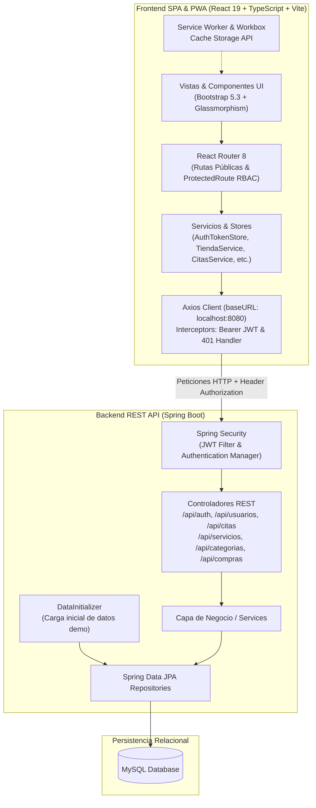

# Portal Clínico NutriVida (Alchemax)

[](https://react.dev/)
[](https://www.typescriptlang.org/)
[](https://vitejs.dev/)
[](https://reactrouter.com/)
[](https://getbootstrap.com/)
[](https://vite-pwa-org.netlify.app/)
[](https://axios-http.com/)
[](https://spring.io/)
[](https://pages.github.com/)

**NutriVida** es una plataforma web progresiva (PWA) de alto rendimiento orientada a la gestión integral de salud, telemedicina y nutrición clínica personalizada. Diseñada con una arquitectura moderna de **Single Page Application (SPA)** desacoplada, NutriVida se comunica de forma segura mediante **JSON Web Tokens (JWT)** con un backend REST API desarrollado en **Spring Boot** y respaldado por una base de datos relacional **MySQL**.

La plataforma provee una experiencia clínica 360° con control de acceso basado en roles (**RBAC**), atendiendo las necesidades de **Pacientes**, **Especialistas Nutricionistas** y **Administradores Clínicos**.

---

## 📑 Tabla de Contenidos

- [Características Principales](#-características-principales)
- [Arquitectura del Sistema](#-arquitectura-del-sistema)
- [Perfiles de Usuario y Roles (RBAC)](#-perfiles-de-usuario-y-roles-rbac)
- [Módulos de la Aplicación](#-módulos-de-la-aplicación)
- [Stack Tecnológico](#-stack-tecnológico)
- [Estructura del Proyecto](#-estructura-del-proyecto)
- [Integración con Backend REST API](#-integración-con-backend-rest-api)
- [Guía de Instalación y Ejecución](#-guía-de-instalación-y-ejecución)
- [Credenciales de Prueba](#-credenciales-de-prueba)
- [Roadmap de Desarrollo](#-roadmap-de-desarrollo)
- [Equipo de Desarrollo](#-equipo-de-desarrollo)

---

## 🚀 Características Principales

- **Arquitectura Cliente-Servidor Real:** Migración completa desde prototipo local a consumo de API REST en Spring Boot (`http://localhost:8080`) con persistencia en MySQL para usuarios, citas, catálogo clínico, categorías, carrito y compras.
- **Autenticación Robusta y Sesión JWT:** Manejo de credenciales con tokens Bearer JWT, validación de caducidad en cliente, umbral de refresco proactivo (30 min) y captura automática de sesiones expiradas (código HTTP 401) con redirección controlada.
- **Control de Acceso Basado en Roles (RBAC):** Rutas protegidas (`ProtectedRoute`) que segregan las vistas de acuerdo al rol del usuario autenticado: `usuario` (Paciente), `nutricionista` (Especialista) y `admin` (Administrador del sistema).
- **Portal del Paciente Integral (`/account`):** Panel con múltiples pestañas para visualización de resumen biométrico, control de plan nutricional diario (seguimiento de macronutrientes y checklist de comidas), evolución biométrica, descarga de órdenes/exámenes médicos y gestión de citas clínicas.
- **Historial y Detalle de Compras (`AccountPurchasesTab`):** Registro de transacciones con identificadores de operación (`#CMP-XXXX`), estados de servicio (`Activo`, `Completado`, `Cancelado`), desglose de prestaciones y agendamiento directo de consultas vinculadas a servicios adquiridos.
- **Pasarela de Pago Simulada estilo Webpay (`PaymentGatewayModal`):** Experiencia de checkout con soporte para Tarjeta de Crédito (cuotas), Débito / Redcompra con selección de bancos chilenos (BancoEstado, Banco de Chile, Santander, BCI, etc.) y PayPal, detección automática de marca de tarjeta (Visa, Mastercard, Amex, Redcompra), validación de campos y animación de procesamiento.
- **Centro de Mando del Nutricionista (`/nutricionista`):** Espacio especializado para gestión de agenda de consultas, seguimiento de pacientes, revisión de fichas médicas, administración de solicitudes de laboratorio y catálogo de planes.
- **Panel Administrativo y Reportes Ejecutivos (`/admin`):**
  - **Dashboard de Reportes:** Métricas de rendimiento filtrables por período (`Hoy`, `Semana`, `Mes`, `Año`, `Histórico`), ingresos reales, volumen de transacciones, ticket promedio y ranking de servicios más solicitados.
  - **Supervisión de Operaciones:** Gestión y cambio de estados de compras y citas clínicas de pacientes.
  - **Gestión de Catálogo y Categorías:** CRUD completo de prestaciones y taxonomía clínica.
  - **Gestión de Identidades:** Administración y búsqueda en tiempo real de usuarios con asignación de roles.
  - **Terminal Alchemax CLI:** Consola administrativa UNIX simulada (`Alchemax OS v11.0.4`) con manuales (`man`), ejecución de comandos (`useradd`, `passwd`, `ls`, `cat`, `systemctl`, `top`, `reboot`, etc.) y registro en tiempo real de eventos del sistema.
- **Motor de Triage Clínico:** Calculadora biométrica interactiva en la página de inicio que computa el IMC en tiempo real y recomienda automáticamente el plan nutricional más adecuado.
- **Asistente Virtual Inteligente ("Vida"):** Chatbot clínico flotante disponible en toda la aplicación para orientación médica inicial, consultas de precios, navegación y soporte.
- **Soporte PWA (Progressive Web App):** Configuración con `vite-plugin-pwa` y Workbox para almacenamiento en caché de recursos estáticos (`CacheFirst`), auto-actualización silenciosa y capacidades offline básicas.

---

## 🏗️ Arquitectura del Sistema



---

## 👥 Perfiles de Usuario y Roles (RBAC)

La plataforma cuenta con un sistema de rutas protegidas (`ProtectedRoute`) que evalúa el rol contenido en la sesión y token JWT:

| Rol | Ruta Principal | Capacidades y Alcance |
| :--- | :--- | :--- |
| **`usuario`** (Paciente) | `/Alchemax/account`<br/>`/Alchemax/carrito` | Gestión de perfil, consulta de pautas alimenticias y macros, registro de evolución biométrica, solicitud de citas, revisión de compras realizadas y checkout en carrito. |
| **`nutricionista`** (Especialista) | `/Alchemax/nutricionista` | Centro de mando de atención, administración de agenda médica, confirmación/reprogramación de citas, fichas de pacientes y solicitudes de exámenes. |
| **`admin`** (Administrador) | `/Alchemax/admin` | Dashboard de reportes financieros por período, operaciones de compra, control maestro de citas, CRUD de catálogo clínico, categorías, gestión de usuarios y consola Terminal CLI. |

---

## 📦 Módulos de la Aplicación

### 1. Portal del Paciente (`/account`)
- **Resumen Clínico:** Vista panorámica del paciente, datos biométricos actuales y estado de consultas activas.
- **Agenda de Citas:** Solicitud de citas presenciales o de telemedicina con validación de horarios y selección de especialista.
- **Plan Nutricional:** Distribución calórica diaria (Kcal), desglose porcentual de macronutrientes (Proteínas, Carbohidratos, Grasas), recomendaciones hídricas y registro interactivo de ingestas diarias.
- **Evolución Biométrica:** Registro histórico de mediciones corporales (peso en kg, % grasa corporal, masa muscular).
- **Ficha y Exámenes:** Historial de exámenes clínicos solicitados por el equipo médico con estado de revisión y descarga de informes.
- **Mis Compras:** Listado de prestaciones y planes adquiridos con código `#CMP-XXXX`, detalle por ítem y acceso directo para agendar la cita correspondiente.

### 2. Catálogo Clínico y Checkout (`/metodologia`, `/carrito`)
- Exposición de la metodología de 4 etapas: *Evaluación Inicial*, *Plan a Medida*, *Acompañamiento Continuo* y *Consolidación*.
- Catálogo de servicios filtrable por categorías clínicas (*Evaluación Integral*, *Planes Nutricionales*, *Controles y Seguimiento*).
- Carrito de compras sincronizado con el backend (`/api/carrito/usuario/{id}`).
- Pasarela de pago simulada (`PaymentGatewayModal`) con validación de tarjeta, selección de cuotas o banco emisor y generación automática de la orden de compra.

### 3. Panel de Administración (`/admin`)
- **Dashboard Ejecutivo:** Filtros temporales (`Hoy`, `Semana`, `Mes`, `Año`, `Histórico`), totales de recaudación, conteo de órdenes, ticket promedio y servicios más demandados.
- **Operaciones:** Listado integral de compras y citas con capacidad de modificar estados en base de datos (`Activo`, `Completado`, `Cancelado`).
- **Servicios y Categorías:** Modales de creación, edición y eliminación de prestaciones y categorías clínicas.
- **Gestión de Usuarios:** Listado de usuarios con buscador en tiempo real, cambio de contraseñas, edición de datos y asignación de roles.
- **Terminal Alchemax:** Entorno CLI interactivo embebido con comandos de sistema y páginas de manual estilo Linux (`man [comando]`).

### 4. Módulos Informativos y de Soporte
- **Home (`/`):** Triage biométrico interactivo con cálculo dinámico de IMC.
- **Telemedicina (`/telemedicina`):** Información sobre la modalidad de atención remota, requisitos técnicos y cobertura.
- **Blog Clínico (`/blog`, `/blog/:articleId`):** Artículos educativos y de divulgación nutricional con filtros temáticos.
- **Preguntas Frecuentes (`/faq`):** Respuestas a inquietudes sobre servicios, telemedicina, métodos de pago y reembolsos de salud.
- **Testimonios (`/testimonios`):** Historias de éxito y valoraciones de pacientes.
- **Chatbot Asistente ("Vida"):** Motor de asistencia conversacional con respuestas rápidas guiadas por intenciones.

---

## 🛠️ Stack Tecnológico

### Frontend
- **Librería Principal:** [React 19](https://react.dev/) (Componentes funcionales, Hooks avanzados, Suspense y Code-Splitting con `lazy`).
- **Lenguaje:** [TypeScript 5.x / 6.x](https://www.typescriptlang.org/) (Tipado estricto en modelos, DTOs y estados).
- **Bundler y Servidor de Desarrollo:** [Vite 8](https://vitejs.dev/) con ESM de alta velocidad.
- **Enrutamiento:** [React Router 8](https://reactrouter.com/) con rutas protegidas por rol y `ScrollToTop`.
- **Diseño y Estilos:** [Bootstrap 5.3](https://getbootstrap.com/), utilidades CSS personalizadas y sistema de diseño Glassmorphism responsivo.
- **Cliente HTTP:** [Axios 1.21](https://axios-http.com/) con interceptores de autenticación y manejo de errores.
- **PWA y Caché:** [vite-plugin-pwa](https://vite-pwa-org.netlify.app/) con Workbox (`generateSW`).
- **Linters y Formato:** ESLint 10, typescript-eslint 8.

### Backend y Base de Datos
- **Framework:** Spring Boot (Java).
- **Seguridad:** Spring Security con autenticación basada en JWT.
- **Capa de Persistencia:** Spring Data JPA y Hibernate.
- **Base de Datos:** MySQL (con migración/inicialización automática vía `DataInitializer`).

---

## 📂 Estructura del Proyecto

```text
Alchemax/
├── public/                     # Recursos estáticos, manifest PWA e íconos
├── src/
│   ├── api/                    # Configuración de Axios e interceptores HTTP
│   │   └── axiosConfig.ts      # Cliente API con inyección de JWT y manejo de 401
│   ├── assets/                 # Recursos multimedia, logotipos e iconografía
│   ├── components/             # Componentes transversales reutilizables
│   │   ├── account/            # Pestañas del portal del paciente (Plan, Citas, Evolución, Compras)
│   │   ├── admin/              # Componentes del panel admin (Sidebar, StatCards, Modales CRUD)
│   │   ├── nutricionista/      # Componentes del portal nutricionista (Sidebar, Productos, Categorías)
│   │   ├── Chatbot.tsx         # Asistente virtual clínico "Vida"
│   │   ├── Layout.tsx          # Estructura base (Navbar + Suspense Outlet + Footer + Chatbot)
│   │   ├── Navbar.tsx          # Barra de navegación con control de sesión dinámico
│   │   ├── PaymentGatewayModal.tsx # Pasarela de pago simulada (Webpay / Tarjetas / Bancos)
│   │   ├── ProtectedRoute.tsx  # Guard de navegación con validación de roles RBAC
│   │   └── ScrollToTop.tsx     # Restaurador automático de posición de scroll
│   ├── data/                   # Datos de prueba y configuración semilla (seedData)
│   ├── pages/                  # Vistas principales de las rutas
│   │   ├── Account.tsx         # Portal del Paciente
│   │   ├── Admin.tsx           # Panel de Control Administrativo y Terminal CLI
│   │   ├── Article.tsx         # Lector individual de artículos del blog
│   │   ├── Blog.tsx            # Directorio del blog clínico
│   │   ├── Carrito.tsx         # Carrito de compras conectado a la API
│   │   ├── Faq.tsx             # Preguntas frecuentes
│   │   ├── Home.tsx            # Portada principal con Triage Clínico
│   │   ├── Login.tsx           # Formulario de autenticación con redirección por rol
│   │   ├── Metodologia.tsx     # Metodología y Catálogo clínico de servicios
│   │   ├── NotFound.tsx        # Página de error 404
│   │   ├── Nutricionista.tsx   # Portal del especialista nutricionista
│   │   ├── Register.tsx        # Registro de pacientes con validaciones estrictas
│   │   ├── Telemedicina.tsx    # Información sobre consultas remotas
│   │   └── Testimonios.tsx     # Reseñas y casos de éxito
│   ├── services/               # Capa de servicios para comunicación con la API REST
│   │   ├── citasService.ts     # CRUD de citas médicas con mapeo de DTOs
│   │   ├── planService.ts      # Gestión de pautas nutricionales y métricas biométricas
│   │   ├── storageCategorias.ts # Gestión de categorías clínicas contra backend
│   │   ├── storageProductos.ts  # Gestión de servicios clínicos contra backend
│   │   ├── storageUsuario.ts    # Autenticación, registro y perfil de usuarios
│   │   └── tiendaService.ts     # Carrito, compras y reportes administrativos
│   ├── types/                  # Definiciones de TypeScript e interfaces del dominio
│   ├── utils/                  # Utilidades y funciones auxiliares
│   │   ├── authToken.ts        # Almacenamiento seguro en memoria y decodificación de JWT
│   │   ├── authValidation.ts   # Validaciones de formularios, contraseña, RUT y roles
│   │   └── formatPriceCLP.ts   # Formateador de moneda en pesos chilenos (CLP)
│   ├── App.tsx                 # Enrutador principal y definición de rutas protegidas
│   ├── main.tsx                # Punto de montaje de React en el DOM
│   └── index.css               # Variables globales CSS, glassmorphism y animaciones
├── eslint.config.js            # Configuración de linter ESLint 10
├── index.html                  # Plantilla HTML base
├── package.json                # Dependencias, metadatos y scripts del proyecto
├── tsconfig.json               # Configuración del compilador TypeScript
└── vite.config.ts              # Configuración de Vite y plugin PWA (Workbox)
```

---

## 🔌 Integración con Backend REST API

El frontend se comunica con el servidor Spring Boot en `http://localhost:8080` a través de los siguientes endpoints:

| Módulo | Método | Endpoint | Descripción |
| :--- | :--- | :--- | :--- |
| **Auth** | `POST` | `/api/auth/login` | Autenticación de usuario; retorna token Bearer JWT y datos de sesión. |
| **Auth** | `POST` | `/api/auth/register` | Registro de nuevos usuarios con rol `usuario`. |
| **Usuarios** | `GET` | `/api/usuarios` | Listado completo de usuarios registrados (Admin). |
| **Usuarios** | `GET` | `/api/usuarios/perfil` | Consulta del perfil autenticado actual. |
| **Usuarios** | `PUT` | `/api/usuarios/{id}` | Actualización de datos y roles de usuario. |
| **Citas** | `GET` | `/api/citas` | Consulta de todas las citas del sistema (Admin / Nutricionista). |
| **Citas** | `GET` | `/api/citas/usuario/{usuarioId}` | Consulta de citas correspondientes exclusivamente al paciente. |
| **Citas** | `POST` | `/api/citas` | Creación y agendamiento de una nueva cita clínica. |
| **Citas** | `PUT` | `/api/citas/{id}/estado` | Actualización de estado (`Programada`, `Confirmada`, `Completada`, `Cancelada`). |
| **Servicios**| `GET` | `/api/servicios` | Obtención del catálogo de planes y servicios clínicos. |
| **Servicios**| `POST` | `/api/servicios` | Alta de nuevo servicio clínico (Admin). |
| **Servicios**| `PUT` | `/api/servicios/{id}` | Modificación de servicio existente (Admin). |
| **Servicios**| `DELETE`| `/api/servicios/{id}` | Eliminación lógica/física de servicio. |
| **Categorías**| `GET` | `/api/categorias` | Obtención de taxonomía y categorías clínicas. |
| **Categorías**| `POST` | `/api/categorias` | Creación de nueva categoría (Admin). |
| **Carrito** | `GET` | `/api/carrito/usuario/{usuarioId}` | Consulta de los productos activos en el carrito del paciente. |
| **Carrito** | `POST` | `/api/carrito/usuario/{usuarioId}/agregar` | Agregar servicio al carrito. |
| **Carrito** | `DELETE`| `/api/carrito/usuario/{usuarioId}/remover` | Quitar servicio específico del carrito. |
| **Carrito** | `DELETE`| `/api/carrito/usuario/{usuarioId}/vaciar` | Vaciar todos los ítems del carrito. |
| **Compras** | `GET` | `/api/compras/usuario/{usuarioId}` | Historial de compras del paciente. |
| **Compras** | `POST` | `/api/compras/procesar` | Procesamiento de orden de compra desde checkout. |
| **Compras** | `GET` | `/api/compras/reporte?periodo={periodo}` | Reporte administrativo de ingresos, tickets y ranking por período. |
| **Compras** | `PUT` | `/api/compras/{id}/estado` | Cambio de estado de una compra (`Activo`, `Completado`, `Cancelado`). |

---

## 💻 Guía de Instalación y Ejecución

### Requisitos Previos

- [Node.js](https://nodejs.org/) (versión 18.0.0 o superior).
- [npm](https://www.npmjs.com/) (incluido con Node.js).
- **Backend NutriVida:** Servidor Spring Boot en ejecución en `http://localhost:8080` conectado a MySQL.

### Pasos de Instalación

1. **Clonar el repositorio:**
   ```bash
   git clone https://github.com/Russentt/Alchemax.git
   cd Alchemax
   ```

2. **Instalar dependencias:**
   ```bash
   npm install
   ```

3. **Iniciar el servidor de desarrollo:**
   ```bash
   npm run dev
   ```

4. **Acceder a la aplicación:**
   Abre tu navegador en la URL indicada en la terminal (por defecto `http://localhost:5173/Alchemax/`).

### Scripts Disponibles

| Comando | Descripción |
| :--- | :--- |
| `npm run dev` | Inicia el servidor de desarrollo local con Vite y HMR. |
| `npm run build` | Compila TypeScript (`tsc -b`) y genera el bundle optimizado para producción en `dist/` incluyendo service workers PWA. |
| `npm run preview` | Sirve localmente la versión de producción generada en `dist/`. |
| `npm run lint` | Ejecuta ESLint para verificar estándares de código y buenas prácticas. |
| `npm run deploy` | Compila y despliega automáticamente la versión a la rama `gh-pages`. |

---

## 🔑 Credenciales de Prueba

Para probar los diferentes roles y módulos del sistema en un entorno de desarrollo, utiliza las siguientes credenciales preconfiguradas:

| Rol | Correo Electrónico | Contraseña | Vista Inicial |
| :--- | :--- | :--- | :--- |
| **Administrador** | `admin@gmail.com` | `admin123` | `/Alchemax/admin` |
| **Nutricionista** | `michael@gmail.com` | `nutri123` | `/Alchemax/nutricionista` |
| **Paciente** | `camila.soto@gmail.com` | `user123` | `/Alchemax/account` |

---

## 🗺️ Roadmap de Desarrollo

### Funcionalidades Implementadas ✅
- [x] Migración completa de persistencia local a API REST en Spring Boot + MySQL.
- [x] Autenticación JWT con Bearer Token, intercepción global de 401 y validación de expiración.
- [x] Control de acceso basado en roles (RBAC) con `ProtectedRoute` para `admin`, `nutricionista` y `usuario`.
- [x] Panel de Administración con Dashboard de reportes financieros por período (`Hoy`, `Semana`, `Mes`, `Año`, `Histórico`).
- [x] Supervisión operativa de compras y citas clínicas con actualización de estados en base de datos.
- [x] Consola interactiva Terminal Alchemax CLI (`Alchemax OS`) con páginas de manual (`man`) y log de eventos.
- [x] Portal especializado para Nutricionistas con agenda médica, citas y gestión de fichas.
- [x] Pestaña de historial de compras en el portal del paciente con desglose de servicios y botón para agendar.
- [x] Pasarela de pago simulada estilo Webpay con tarjetas de débito/crédito, cuotas y selección bancaria.
- [x] Integración de Progressive Web App (PWA) con Service Workers y caché Workbox.

### Próximos Pasos 📋
- [ ] **Visualización Gráfica Interactiva:** Incorporación de gráficos de evolución corporal (peso, IMC, % grasa) utilizando librerías como Recharts o Chart.js.
- [ ] **Persistencia Backend de Pautas y Exámenes:** Creación de endpoints SQL dedicados en Spring Boot para asignación dinámica de dietas personalizadas y carga de archivos PDF de exámenes clínicos.
- [ ] **Integración de Pasarela Real:** Conexión con la API de producción de Transbank Webpay Plus o MercadoPago.
- [ ] **Notificaciones Push PWA:** Recordatorios automáticos de citas médicas y tomas de agua/ingestas programadas.

---

## 👥 Equipo de Desarrollo

Proyecto académico de ingeniería de software desarrollado para la asignatura **DSY1104** en **DUOC UC**.

- **Equipo:** Colo Colo
- **Integrantes:**
  - Ignacio Battistoni
  - Lucas Ortiz
  - Cristopher Rojas
